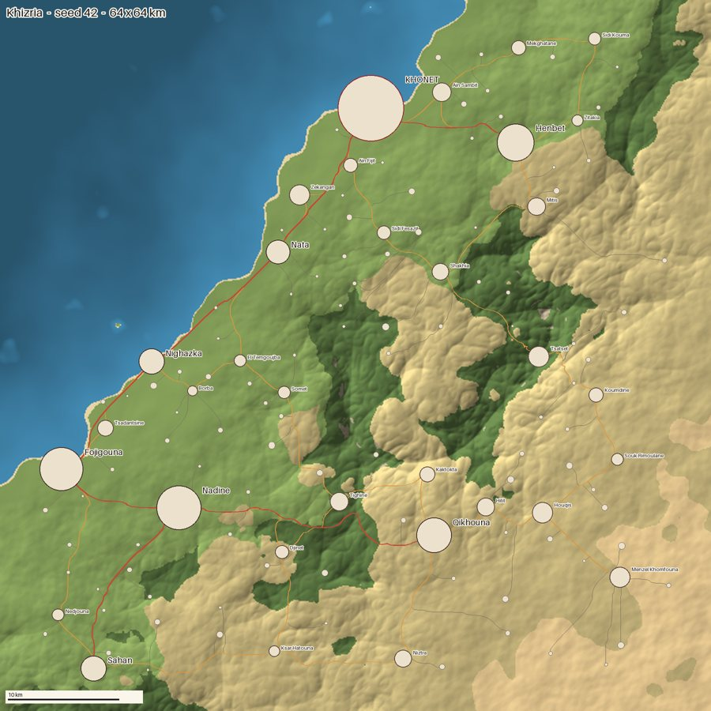
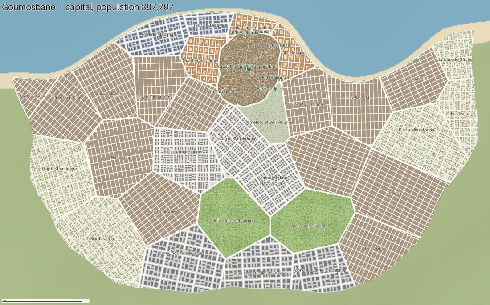
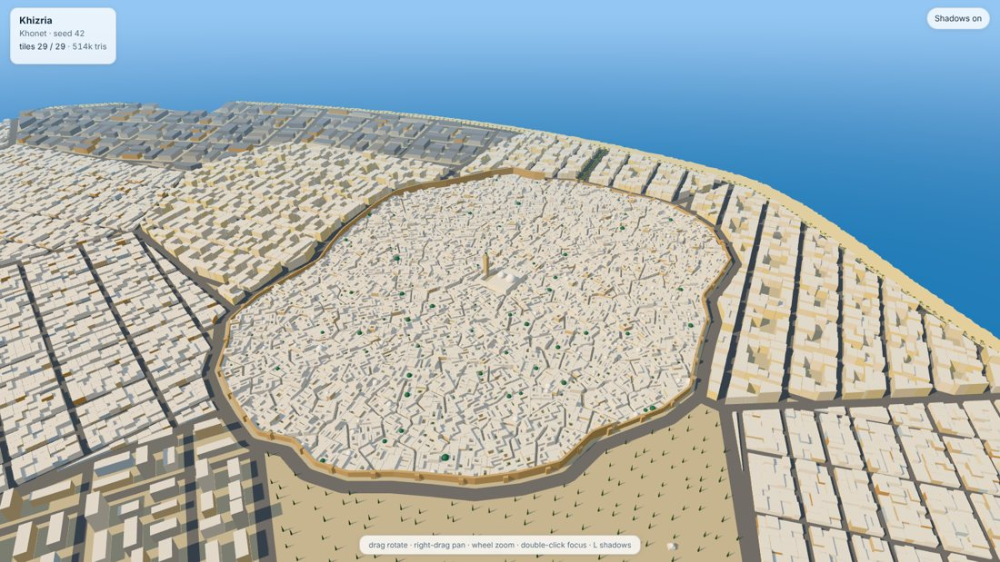
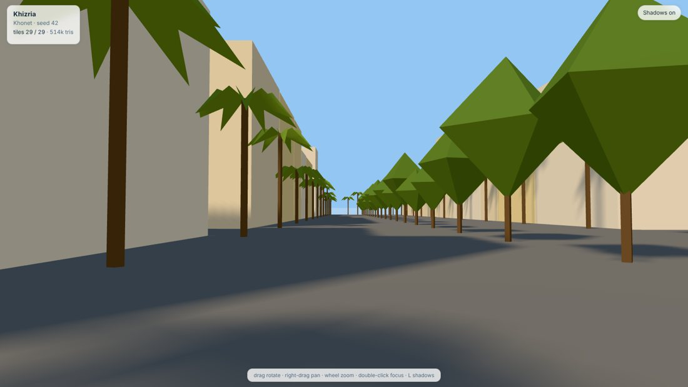
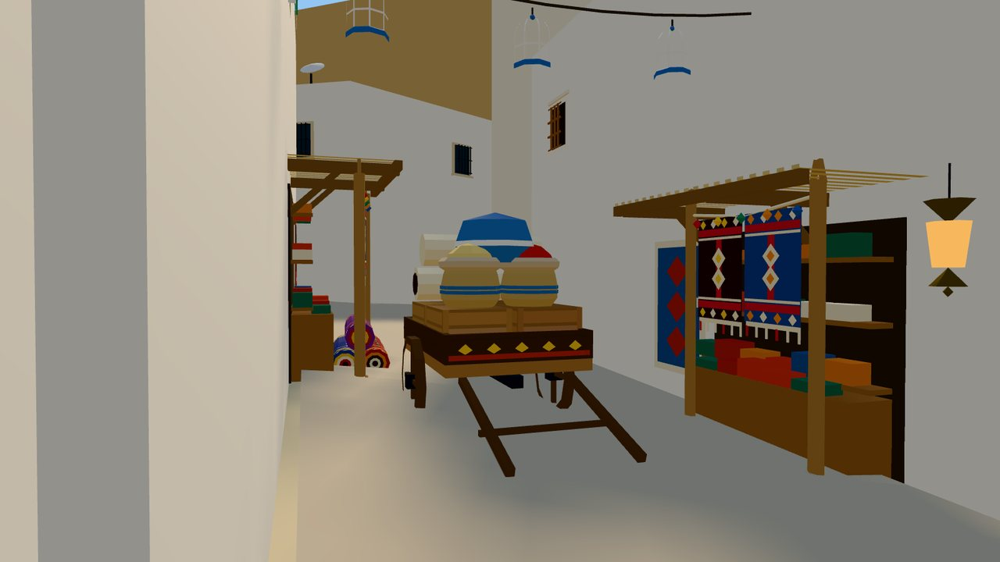
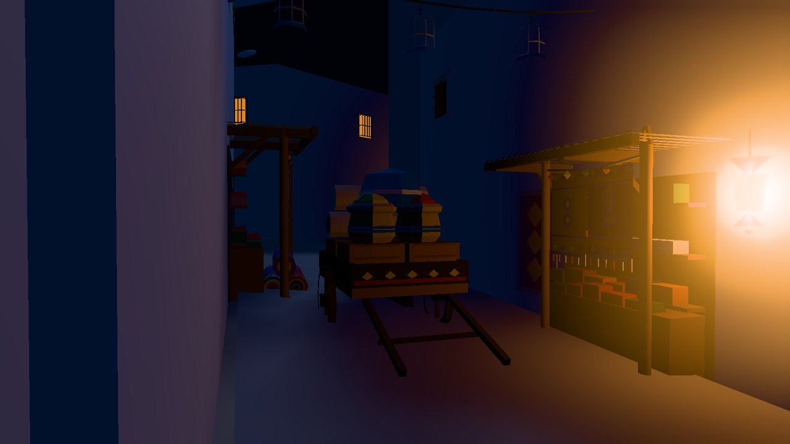
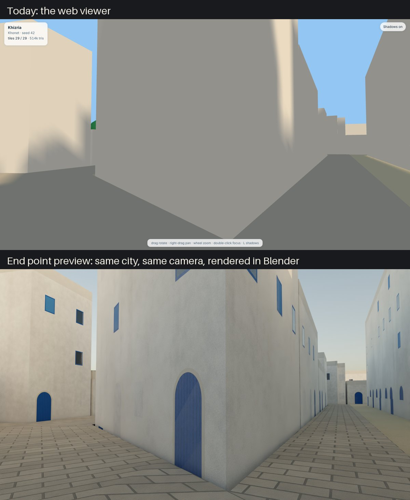

# City - an invented country, generated

This project generates a whole fictional country with a Mediterranean and North African feel.
It has a coast, mountains, steppe and desert, towns and villages joined by roads, and detailed
cities. The cities have walled old towns (medinas) with markets and mosques, colonial
boulevards, ports, apartment blocks, villas, parks and cemeteries. Their streets are dressed:
studded doors, window grilles, wooden balconies, lamps, flowers, shops full of goods, laundry,
mopeds and cats, and a family with a name and a trade behind every house door. You get the result
three ways: **maps** (images), **data files** for stories and games, and **3D files** for Blender
and game engines.

| The country | The capital |
|---|---|
|  |  |
| **The old town in 3D** | **On the boulevard** |
|  |  |
| **The carpet souk** | **The same souk at night** |
|  |  |

**Where it is going.** The same old-town lane, today (top) and as a Blender preview of the
finished look (bottom): textures, blue doors, windows and soft light on the very same geometry.



## How it works, in one minute

Nothing is drawn by hand. A program (the **generator**) builds everything from rules. You give
it a **seed**, which is just a number, and it always builds exactly the same world from that
number. A different seed gives a different country. So:

- the world never has to be downloaded or stored: the seed and the settings are enough;
- it can be as big as your computer can handle;
- your stories stay consistent, because the same place always comes back the same.

## Quick start

1. Install **Python 3.11 or newer** from python.org.
2. Open a terminal in this folder and run:
   ```
   pip install -r requirements.txt
   python -m citygen build
   ```
   This takes about a minute and a half and prints what it is doing.
3. Look at the result:
   ```
   python -m citygen view
   ```
   Your web browser opens the city in 3D. Drag to turn, right-drag to move, use the wheel to zoom,
   and double-click a spot to fly around it. **Click a house to see who lives there** (family,
   trade, how many people, how well off), or a souk to see its name and trade. Press `N` for
   night (lamps, lanterns and some windows light up) and `L` to switch shadows on or off. The
   images are in `output/<country>-<seed>/maps/`.

To save 3D pictures without opening a browser (handy for checks): `pip install playwright`,
then `python -m citygen snapshot --view aerial` (or `street`, `souk`, `top`).

Tip: `python -m citygen build --quick` makes a small test world in under a minute.

## What you get

Everything goes into `output/<country name>-<seed>/`:

| File | What it is |
|---|---|
| `maps/country.png` | Map of the whole country with towns and roads |
| `maps/<city>.png` | Detailed map of a city: districts, streets, buildings |
| `gazetteer.md` | A readable guide to the world for writing stories (places, what they are known for, districts, gates, mosques) |
| `world.json` | All places and roads as data, for a game or a tool |
| `cities/<city>/plan.json` | Every street, building, tree, household and souk of a city as data |
| `tiles/*.glb` | The 3D world, cut into squares of 512 m ("tiles") |
| `tiles/index.json` | List of the tiles and where they go |
| `summary.json` | Counts and timings |

## Open it in Blender

1. Open Blender (3.6 or newer), go to the **Scripting** tab and open `tools/blender_import.py`.
2. Change the `TILES_DIR` line at the top to your `output/<country>-<seed>/tiles` folder.
3. Press **Run Script**. The tiles, a sun, a sky color and a camera are added.

Or from a terminal: `blender --python tools/blender_import.py -- output/<country>-<seed>/tiles`
(on a Mac, `blender` is `/Applications/Blender.app/Contents/MacOS/Blender`). Tested with
Blender 3.6 and 5.2.

**Beautiful pictures for your stories:** `tools/blender_beauty.py` renders a finished-looking
image (golden-hour light, textured walls, roof parapets, and the street dressing of the tiles):

```
blender -b --python tools/blender_beauty.py -- output/<country>-<seed> --view souk --png lane.png
```

Views are `aerial`, `street` and `souk`. Each picture takes about 5 minutes on a normal computer.

## The street kit (Tounes Rush)

Doors, windows, balconies, lamps, pots, palms, carts and market goods come from a **kit**: a
folder of small 3D pieces. `kits/tounes/` holds 51 pieces taken from the game *Tounes Rush*, so
both projects share one look; the generator adds its own pieces (shops stocked by trade, awnings,
spice stalls, chechia shelves, water tanks, cats, street lamps...). Which piece goes where, and
how often, is written in `styles/maghreb.toml` under `[dressing.roles]`: a rich family in the old
town gets a studded Sidi Bou Said door, a carved frame and maybe a wooden balcony; a souk of
potters fills its shelves with pots.

To see every piece in one 3D grid: `python -m citygen kit-sheet`, then
`python -m citygen view output/kit-sheet`.

## Make your own world

Copy `worlds/example.toml`, change the numbers (seed, size, where the sea is, a country name),
and run:

```
python -m citygen build --world worlds/my_world.toml
```

Choose what to build in 3D with `--area`:

| Area | What |
|---|---|
| `capital-center` | The middle of the capital (default, fast) |
| `capital` | The whole capital (a few minutes) |
| `"city:Nata"` | One whole town or city by name (`python -m citygen list` shows them) |
| `box:30,28,34,32` | A rectangle, in kilometers |
| `all` | The whole country (hours, and many gigabytes) |

**For stories:** once you have written about a place, pin its name in your world file under
`[canon.names]` so it never changes, even if the generator gets new features.

## Change how it looks

`styles/maghreb.toml` holds the look and the "language" of the world: colors, how tall
buildings are, how big the old town is, which kinds of districts a city has, and the sounds used
to invent names. Edit a number, rebuild, and look. A completely different culture or era is just
a new file in `styles/`.

## Use it in a game

The `.glb` tiles open in **Godot 4**, **Unreal 5** (glTF import) and **Unity** (glTFast). Each
tile already sits in the right place, and `tiles/index.json` tells a game which tiles exist so
it can load only the ones near the player. A ready-made Godot starter is planned (roadmap task C3).

## Working with Claude

The plan of future improvements is in `docs/ROADMAP.md`, cut into small tasks, and
`docs/PROMPTS.md` has a ready prompt for each one (one new session per task). How to work
cheaply (which model, ultracode) is in `docs/WORKFLOW.md`, the project's memory (goals,
decisions, lessons) in `docs/HANDOFF.md`, and the technical rules in `docs/SPEC.md`.

## Project map

| Folder | Content |
|---|---|
| `citygen/` | The generator (Python) |
| `styles/` | Style packs: look, names, building rules |
| `worlds/` | Your world settings files |
| `kits/` | 3D piece kits for the street dressing (`kits/tounes/` from Tounes Rush) |
| `tools/` | 3D viewer, Blender import, snapshot tool |
| `tests/` | Automatic checks (`python -m pytest -q`) |
| `docs/` | Spec, roadmap, workflow |

## Words used here

- **Seed**: the starting number. Same seed, same world.
- **Procedural**: made by rules in a program instead of by hand.
- **Tile**: one 512 m x 512 m square piece of the 3D world, saved as its own file.
- **glTF / .glb**: a standard 3D file format that most 3D programs and game engines open.
- **Medina**: the old walled town, with narrow alleys and courtyard houses.
- **Souk**: a market street. Here, the main streets from the town gates to the great mosque.
- **Colonial quarter (ville nouvelle)**: the newer district with a grid of streets and a wide boulevard.
- **Parcel**: one building lot.
- **Style pack**: the settings file that decides how everything looks and sounds.
- **LOD (level of detail)**: lighter versions of far-away tiles, so a game runs fast.
- **Kit**: a set of small 3D pieces (doors, lamps, goods) that dress the streets.
- **Instancing**: drawing one 3D model many times (one door model on thousands of houses), so files stay small.
- **Sabat**: a room built over an alley, joining the houses on both sides; the alley runs underneath.
- **Mashrabiya**: a closed wooden balcony with a lattice, to look out without being seen.
- **Chechia**: the red felt hat of Tunisia; the chechia makers have their own souk.
